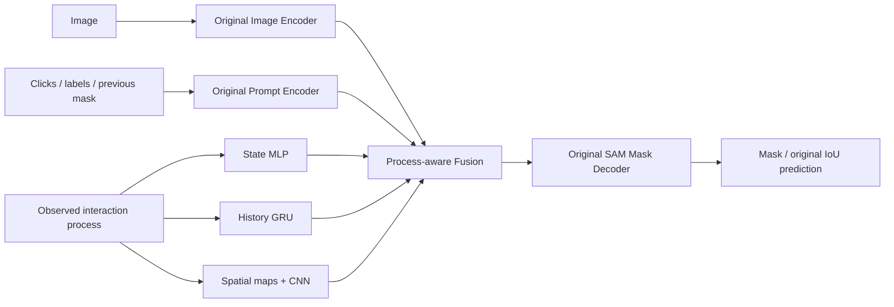

# Process-aware EfficientViT-SAM

当前研究主线：保留 EfficientViT-SAM 原始 Image Encoder、Prompt Encoder 和 Mask Decoder，
并行增加 Interaction Process Encoder，通过 Process-aware Fusion 接入原有 Decoder 接口。
独立实现位于 `efficientvit/models/process_sam`。



Image Encoder 每张图运行一次并缓存 `[B,256,64,64]` 特征。Image/Prompt Encoder 均冻结并保持
eval 模式。Mask Decoder 保留原始结构，E0–E3 使用相同学习率微调。
Prompt Encoder 编码点击位置与正负类型，图像语义与目标关联由解码器学习。
过程分支学习行为与关注区域的关系，不预设“慢速移动必然意味着关注猫尾巴”。

## 第三个 Encoder

编码器不读取图像特征或原生 prompt embedding，分别输出三个表示：

| 分支 | 输入 | 实现 | 输出 |
| --- | --- | --- | --- |
| 当前状态 | 点击坐标/正负类型、过程统计、zoom/viewport、有效性 | 28→128→256 MLP + LayerNorm | `state_token [B,256]` |
| 历史状态 | 按时间排列的状态编码，最多 5 轮 | GRUCell，hidden=128，投影至 256 | `history_token [B,256]` |
| 空间区域 | 当前视口、历史正点击图、历史负点击图、观测轨迹密度图 | 4→32→256 轻量 CNN | `spatial_features [B,256,64,64]` |

28 维状态由点击三维信息、18 维过程统计及其有效性、5 维 viewport 及其有效性构成。
过程统计复用严格对齐数据中的观测时间、覆盖率、路径长度、速度、减速、悬停等信息，顺序见
`PROCESS_FEATURE_NAMES`；只用选中的训练数据拟合标准化参数。
缺失过程记录使用有效性标记，不生成虚构轨迹；点击仍可形成状态表示。
历史 padding 不更新 GRU。轨迹使用固定点击前 2 秒窗口，保留实际观测部分的有效性。
空间 raster 的宽度为 1.5 个特征网格；时间/速度由过程统计与历史分支提供。

输入坐标约定：

- `point_coords [B,N,2]`：SAM 的 1024×1024 padding 坐标系中的像素位置。
- `coordinate_scale [B,2]`：resize 后、padding 前图像的 `(width,height)`。
- `viewports [B,N,5]`：`(zoom,cx,cy,visible_width,visible_height)`，位置/范围以原图归一化。
- `click_trajectories [B,N,T,3]`：相对当前点击的 `(time,dx,dy)`，dx/dy 以原图归一化。
- `process_features [B,N,18]`：未标准化的过程统计。
- 分别提供 `[B,N]` 或 `[B,N,T]` 有效性标记；点击 label=-1 表示 padding。

实际 viewport 范围由 viewport 像素宽高除以同单位的图像 render 宽高计算，zoom 单独编码。
空间图先映射到 resize 后的有效区域，再放入 SAM canvas；padding 区域不做空间调制。
适配器使用记录中的 logical render 尺寸与 viewport 尺寸，接入其他采集系统时必须保证单位一致。

## 第四步：Process-aware Fusion

方案 A 对应 E1/E2：保留原生 sparse/dense prompts，追加状态 token，以及 E2 的历史 token。

\[
T'_{prompt}=\operatorname{Concat}(T_{SAM},T^{state},T^{history})
\]

方案 B 对应 E3：空间特征与广播的状态/历史表示相加，经 1×1 CNN 生成有界调制图。

\[
A_t=\tanh(f(F^{spatial}_t+T^{state}_t+T^{history}_t)),\qquad
F'_{img}=F_{img}\odot(1+\tanh(\alpha)A_t)
\]

同时沿用 E2 的 token 拼接，将 `F'_img`、`T'_prompt`、原始 dense prompt 和原始位置编码送入
原始 Mask Decoder。空间标量调制图在视觉特征通道上广播，默认有效强度 0.05，可设为 0。
通过过程 token 调节解码器对点击的解释，通过空间 gate 调节局部视觉特征。
方案 C 不纳入本轮五组实验。

**初始化边界：** alpha=0 保证图像分支不变；额外 token 仍会影响 Transformer attention
归一化，即使 token 数值为零也不保证 mask 与原始 SAM 一致。
E0 及 `use_process=False` 采用原生提示通路，作为严格 identity 对照。
本轮不添加 mask 更新器、认知回归头或过程特有辅助 loss。

## E0–E4 实验协议

| 实验 | 架构/输入 | 验证问题 |
| --- | --- | --- |
| E0 | 标准 EfficientViT-SAM，同样微调原始 Mask Decoder | 匹配训练基线 |
| E1 | E0 + 当前状态 MLP + token concat | 当前状态分支是否有帮助 |
| E2 | E1 + 历史 GRU + history token | 顺序历史是否有帮助 |
| E3 | E2 + 空间编码 + spatial gating | 局部视觉调制是否有帮助 |
| E4 | E3 同一 checkpoint，测试时打乱过程信息 | 对齐过程信息对结果是否有贡献 |

E4 不重新训练。按相同来源、相同历史长度生成不同任务 donor permutation，交换全部过程统计、
viewport、轨迹及有效性；图像、当前/历史点击坐标、正负标签、pre-mask、目标保持一致。
相对轨迹仍锚定到接收任务的点击，所以 E4 仍可利用点击位置与点击历史，不要求降到随机水平。
关注配对 E3−E4 差异及按任务 bootstrap 的置信区间。不能打乱的 singleton stratum 明确失败。

E0–E3 使用相同 pretrained checkpoint、图像分组 split、human-only 数据、事件集合、录制点击与
点击前 mask、epoch 数、采样顺序和累积步数。Mask Decoder 默认学习率 1e-5，新增模块 1e-4；
AdamW，weight decay=1e-4。统一损失为 BCEWithLogits + Dice + 原始 IoU head 的 MSE，权重均为 1。
统一以验证集原图平均 IoU 选择 checkpoint，测试集只用于最终评价。
E0 是匹配微调基线，不能写成完全冻结的 pretrained SAM。

指标为 IoU@1/@3/@5、NoC@90、Boundary IoU、每次交互延迟。IoU/Boundary IoU 在原图分辨率计算。
Boundary IoU 采用 [原作者定义](https://github.com/bowenc0221/boundary-iou-api/blob/master/boundary_iou/utils/boundary_utils.py)，
内侧边界厚度为图像对角线的 2%，计入触及图像边缘的边界。
延迟经过 warmup 和 CUDA synchronize，包含 Prompt/Process Encoder、Fusion、Mask Decoder，
不包含图片 IO、一次性 Image Encoder 或最终 mask 上采样。

**回放限制：** IoU@k 报告各轮事件数，同时提供完整五轮同一 cohort 的 `IoU@k_complete_prefix`。
NoC@90 只在完整 1–5 轮序列上计算，失败记为 6；没有完整序列时输出 N/A。
未观测的点击不插值、不生成、不假定成功。录制 pre-mask 回放不等于把当前模型输出反馈给用户
或点击模拟器的闭环 NoC；后续闭环实验应单独描述点击策略与协议。

## 运行

```powershell
python -m unittest tests.test_process_sam -v

# 每个 split 选 2 个完整五点击任务，1 epoch，仅做集成验证
python tools/run_process_sam_experiments.py --smoke-test `
  --output-dir outputs/process_sam_e0_e4_smoke

# 完整匹配实验：4 组训练 + E3 配对打乱测试
python tools/run_process_sam_experiments.py --epochs 10 `
  --output-dir outputs/process_sam_e0_e4_full
```

产物包括配置/数据/基础 checkpoint 哈希、固定事件列表、训练统计、各组 checkpoint、
逐事件结果、覆盖率、配对置信区间和 `report.md`。
`--smoke-test` 标记为 `integration_smoke`，不能用于宣称性能提升。
正式实验建议在不同 seed 下重复这五组，先看 E3−E4 稳定差异，再讨论行为解释。

## 已执行验证（2026-10-10）

- 14 项单元验证通过，包括原生 mask 等价性、冻结/梯度、时序 padding、空间坐标和打乱协议。
- [五组 GPU 集成验证](../outputs/process_sam_e0_e4_smoke_20261010/report.md)完成，每个 split 2 个完整五点击任务。
- [全量真实用户数据单轮探索实验](../outputs/process_sam_e0_e4_pilot_20261010/report.md)完成：
  训练 1,122 条点击/450 个任务，验证 240 条/99 个任务，测试 228 条/92 个任务，seed=9527。
- E0–E3 checkpoint 中 Image/Prompt Encoder 的 289 个 state tensors 均与原始 checkpoint 完全一致。
  数据图像没有跨 split 重复；E3/E4 的 228 个测试事件相同且无自身 donor。

单轮探索中 E0 平均测试 IoU 为 0.84456，E3 为 0.83626。
E3−E4 按任务配对平均 IoU 差为 −0.00177，bootstrap 95% CI 为 [−0.01756, 0.01369]。
本轮没有显示 E3 的总体收益，也没有显示对齐过程相对打乱过程的稳定优势。
测试 NoC@90 只覆盖完整五点击的 12 个任务。这是单 seed、单 epoch 的初步结果，
不代表充分训练后的性能结论；多 seed 实验尚未执行。

## 完整训练任务（2026-10-10 启动）

已启动后台训练 `outputs/process_sam_e0_e4_full_20261010_seed9527`：
E0–E3 从同一基础 checkpoint 分别训练 10 epoch，seed=9527，使用全部真实用户数据；
E4 使用 E3 验证集最优 checkpoint 做配对打乱测试。其他训练与回放设置保持一致。

- 最新任务位置：[process_sam_latest_run.json](../outputs/process_sam_latest_run.json)。
- 实时状态：[progress.json](../outputs/process_sam_e0_e4_full_20261010_seed9527/progress.json)。
- 实时日志：[train.log](../outputs/process_sam_e0_e4_full_20261010_seed9527/train.log)。
- 每轮保存各组 `history.json`；已完成组保存到 `partial_summary.json`。
- 全部完成后自动生成 `summary.json` 和 `report.md`；异常写入状态及 `stderr.log`。

以实时状态文件为准。用户说“查看结果”时，读取最新任务的位置与状态，再提供当前进度
或完整 E0–E4 对比；不设置主动通知。

单图推理：

```python
from efficientvit.sam_model_zoo import create_efficientvit_sam_model
from efficientvit.models.process_sam import (
    ProcessSAMConfig, ProcessAwareEfficientViTSam, ProcessAwareSamPredictor,
)

base = create_efficientvit_sam_model("efficientvit-sam-l0")
model = ProcessAwareEfficientViTSam(base, ProcessSAMConfig(variant="E3")).cuda().eval()
# 实际部署应加载 best.pt 中的 config（包括训练统计）和 model 权重。
predictor = ProcessAwareSamPredictor(model)
predictor.set_image(rgb_image)
result = predictor.predict((click_x, click_y, 1), viewport=(2.0, 0.75, 0.5, 0.3, 0.4))
```

## 模拟过程最终版实验（2026-10-10）

入口为 `tools/run_process_sam_synthetic_final.py`。仅训练最终 E3，一次 10 epoch；
原始 Frozen L0、过程打乱和过程绕过均只做推理，不再训练 E0/E1/E2。
本次输出为 `outputs/process_sam_synthetic_final_20261010_seed9527`。

- 从本地 COCO 选择 1000 张不同图像，排除全部 641 张真人数据图像，按图像 70/15/15 划分。
- 每个目标生成完整五次点击，模拟移动、停留、缩放、平移、点击时间和逐操作视口。
- 模拟用户以 GT 和当前预测寻找误差区域；模型只接收行为前缀，不接收误差图、GT 或未来行为。
- `use_event_history=True` 时，新增轻量事件 MLP 接入原 GRU。最多保留 64 个按时间排序的事件，
  压缩移动点时优先保留 zoom/pan/click；空间轨迹图只使用最近两秒的移动观察。
- 事件输入为 `process_events [B,L,11]` 和 `process_event_valid [B,L]`，直接传给模型 `forward`。
  11 维为相对秒数/10、原图 x/y、log zoom、可见宽高、move/zoom/pan/click 标记及点击标签。
  原有 Predictor 示例仍是点击级接口；完整事件序列实验使用上述模型输入。
- 生成数据、训练、测试统一 L0；首次点击没有 dense mask prompt，后续保存原始 256×256 logits。
- Image/Prompt Encoder 冻结，Decoder 和 Process Encoder 训练；空间调制强度从零开始。
- 验证集固定 L0 历史回放用于选权重；最终测试由模型自己的预测驱动后续模拟点击。
  打乱/绕过对照使用最终模型同一权重、同一点击和 pre-logits，不将对照预测反馈进主序列。
- 图像特征缓存到磁盘，CPU 只保留 64 张图像的缓存；报告保存为 `summary.json`、`report.txt`。

这是 GT 驱动的模拟用户实验。模拟数据上的收益不能证明真人交互收益，也不能与此前真人测试
直接比较绝对数值。最新任务与实时状态继续通过 `outputs/process_sam_latest_run.json` 查询。
## 补充验证：公平微调、时序对照及真人迁移

入口为 `tools/run_process_sam_validation.py`，复用
`outputs/process_sam_synthetic_final_20261010_seed9527` 的数据、图像缓存和首个种子的完整 E3 权重。
不会重新抽取数据或改动旧训练结果。

- B0：冻结 Image/Prompt Encoder，独立微调原 Mask Decoder。
- B1：同样微调 Decoder，保留视口、点击和轨迹空间分布；移除全部 18 维行为摘要及事件时间输入，使用无序均值聚合和 MLP 替代 GRU。历史模块的参数数目比 GRU 少 256，其余融合接口相同。
- B2：完整 E3。9527 种子复用旧 `best.pt`，后续种子从原基座训练。

三组固定同一 700/150/150 任务划分、回放点击、L0 原生上一轮 logits、损失、优化器和 10 轮预算。
首个种子的配对验证集任务平均 IoU 同时满足 B2−B0 > 0、B2−B1 > 0 时，自动扩展训练种子 9528、9529。
该判据预先保存在 manifest 中，测试集不参与扩展决策，也不用于挑选权重。
每个种子都报告配对任务 Bootstrap 区间，跨种子报告全部差值及均值/标准差。

固定回放与独立闭环分别报告：前者用于相同点击/前置 Mask 上的配对比较；后者每组都使用自身预测的 logits 和纠错点击，五次未达到 90% IoU 的 NoC 记为 6，并同时报告失败数/比例。
行为策略含原真值区域聚焦、点击中心聚焦、点击聚焦慢速以及点击聚焦稀疏采样。
后三种策略不根据真值区域的中心/大小生成视口，但纠错点击仍使用真值误差，仍属于模拟用户测试。
保存各组闭环行为前缀及过程特征的最大标准化偏差，便于区分时序敏感性与输入分布变化。

完整 E3 的四项推理扰动是历史移动顺序、历史时间缩短/延长，以及当前状态的时间/速度摘要中和。
固定图像、点击、前置 logits、当前视口和空间栅格支持；顺序扰动仅在同一移动段、视口和最近窗口内执行。
这些是敏感性诊断。B1 与 B2 仍共享相同的最近两秒轨迹栅格选择，因此 B1 对照检验的是细粒度顺序、时间与行为摘要的额外贡献，不声称去除了所有粗粒度时间信息。

真人测试接入原始 `interaction_tasks.jsonl` 的任务全轨迹、视口动作和点击前的高频轨迹快照。
按事件 ID 定位当前点击动作，以该任务日志标记截断前缀，并记录两套遥测时钟的偏移变化；不声称与物理松开鼠标时刻实现毫秒级精确同步。
保留原有真人留出划分，不做真人微调。首点击不输入密集 Mask，后续统一使用已录制的 L1 二值前置 Mask。
缩放/平移子组只计算第一次点击之后的动作，排除启动时自动适配视口。
该结果属于真人录制回放迁移；原严格样本筛选和单一标注者，以及完整五点击任务较少的限制仍然存在。

```powershell
E:\miniconda\python.exe -u tools/run_process_sam_validation.py --output-dir outputs/process_sam_validation_20261011 --epochs 10 --seeds 9527 9528 9529
```

`progress.json` 提供阶段、组别、种子、轮数及训练步数；`summary.json`、`report.txt` 随每组完成更新。
正式结果与 `--smoke-test` 的流程检查严格区分。

中断后使用相同参数并加 `--resume`。已完成组的训练与评估保持原样；每轮结束的 `last.pt`
保存模型、优化器、AMP、最优模型、训练历史与随机状态，从下一轮恢复。尚未完成的当前轮会重新执行。
旧版只有 `best.pt` 的未完成组不能精确恢复优化器：先在组目录内归档旧权重和历史，再按原种子从原基座重新训练；
`recovery.json` 记录归档路径和已重放轮次的损失/验证差值。原 manifest 保留，恢复记录另存于 `resume_events.json`。
